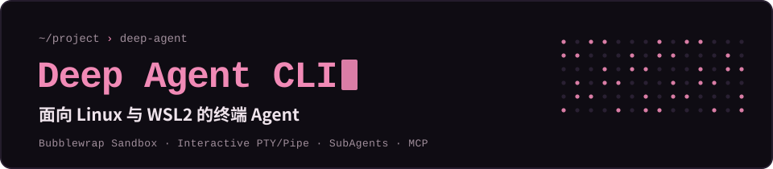
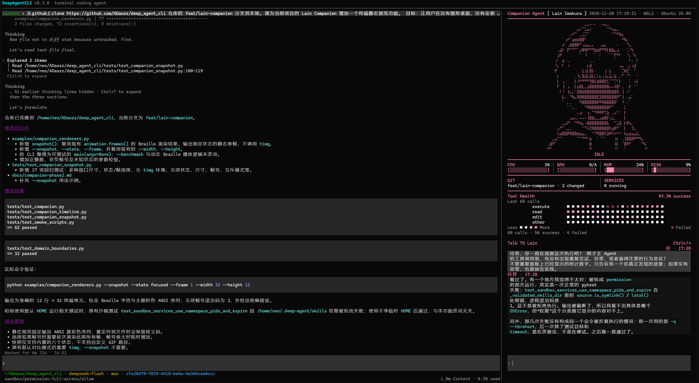
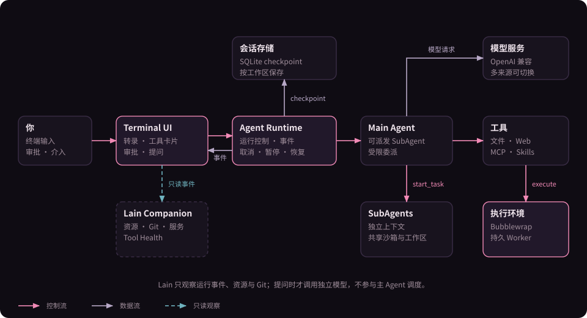

<div align="center">



<p>
  
  
  
  
</p>

<p>
  <a href="#功能概览">功能概览</a> ·
  <a href="#快速开始">快速开始</a> ·
  <a href="#模型与扩展">模型与扩展</a> ·
  <a href="#权限沙箱与凭据">权限、沙箱与凭据</a> ·
  <a href="#架构概览">架构概览</a> ·
  <a href="docs/README.md">完整文档</a>
</p>

<br />



</div>

<br />

**Deep Agent CLI**（`deep-agent`）运行在 Linux 与 WSL2 终端中，用于在当前项目目录下阅读代码、编辑文件、执行沙箱命令并管理多步骤开发任务。

所有工具调用与命令输出都会实时显示在终端转录区，默认在文件改动、命令执行、网页工具和外部 MCP 调用前请求确认，命令通过 Bubblewrap 在隔离环境中运行。如需在其他 Python 程序中复用运行核心，可使用 [Python API](docs/library.md)。

> 当前版本为 **v0.4.0**。在稳定版发布前，配置格式、会话存储结构与 Python API 仍可能出现不兼容变更。

---

## 功能概览

### 终端交互与会话

在项目目录运行 `deep-agent` 进入交互式界面，每轮对话的思考内容、工具调用、文件改动与命令输出按顺序展示在主转录区：

- **工具卡片与 Diff 审阅**：每次文件修改和命令执行显示状态、耗时与摘要；`Ctrl+R` 在原卡片展开完整 Diff，`Ctrl+O` 折叠或展开工具输出，`Ctrl+T` 折叠或展开思考内容。
- **运行中介入与排队**：Agent 运行期间，按 `Enter` 发送 steering 指令介入当前轮次，按 `Alt+Enter` 排队后续任务（`Alt+↑` 可撤回输入框），按 `Esc` 取消当前轮次，`/pause` 在下一个模型安全点暂停。
- **交互面板与会话恢复**：审批、补充提问和敏感信息录入通过独立交互面板完成，按 `F2` 可重新打开挂起的面板；会话保存在 SQLite 中，可通过 `deep-agent resume` 按摘要或 ID 前缀恢复。

### 交互式命令执行

命令在 Bubblewrap 持久 Worker 中执行，支持前后台切换与标准输入交互：

- **实时输出与后台运行**：命令支持设置 `yield_time`；到期时若进程仍在运行，工具先返回当前输出与 `execution_id`，进程继续在后台执行。支持 Pipe 与 PTY 两种模式。
- **标准输入控制**：Agent 可通过 `write_stdin` 向运行中的进程写入输入、轮询输出或终止进程；用户也可以在终端输入 `/stdin` 接管交互输入（PTY 下 `Ctrl+C` / `Ctrl+D` 发送信号，Pipe 下取消或关闭输入，`Esc` 脱离而不终止进程）。
- **代码搜索**：沙箱内置只读挂载的 `rg`（ripgrep），用于代码搜索与文件查找。

### SubAgent 委派

对于可以拆分为独立子问题的任务，主 Agent 可通过 `start_task` 启动独立上下文的 SubAgent：

- **同步与后台执行**：同步子任务可在深度上限内继续向下委派；根 Agent 还可启动后台叶子子任务，终态结果由 Runtime 自动回送至下一个模型边界。
- **界面与配额限制**：TUI 为每个子任务显示独立卡片与状态（`Ctrl+A` 展开或折叠最终结果），内部思考与工具输出不写入主上下文。默认配额为每父节点 4 个并发、全树 10 个、最大嵌套 2 层，且在 `ask` 权限模式下不提供 `start_task`。

### Lain Companion

宽终端（至少 120 列 × 32 行）下右侧显示 Lain Companion 侧栏，也可通过 `/lain` 手动开关或提问：

- **本地监控与 Tool Health**：每 2 秒采样本机 CPU / GPU / RAM / DISK，每 5 秒检查 Git 状态，追踪运行中的服务，并以 60 次调用窗口展示 Tool Health 热力图，同时根据运行事件切换本地 Braille GIF 动画。这部分完全在本地运行，不消耗模型调用。
- **只读伴随对话**：按 `Ctrl+→` 切换到侧栏或输入 `/lain <问题>`，Lain 使用独立模型与只读宿主 RPC 查询当前会话统计、近期工具明细、失败重试和工作区源码。Lain 不参与主 Agent 调度，也不能修改文件或执行命令；`/lain stats` 可在无模型情况下查看上一轮工具统计。

---

## 快速开始

### 环境要求

- **操作系统**：Linux 或 Windows WSL2（需要交互式终端；原生 Windows、macOS 与 WSL1 不支持 Bubblewrap 沙箱）
- **运行依赖**：Python `3.12+`、`bubblewrap`（`bwrap`）
- **模型接口**：任意兼容 OpenAI Chat Completions 或 Responses 接口的模型服务
- **可选**：运行 Node.js 编写的 stdio MCP 服务或 Node 工具时，推荐使用 Node.js 24 最新补丁版；`ripgrep` 随 Python 依赖自动安装

Ubuntu / WSL2 若遇到 user namespace 限制，请参考 [沙箱排查](docs/sandbox.md#排查ubuntu--wsl2)。

### 1. 安装

```bash
# Debian / Ubuntu
sudo apt install pipx bubblewrap
pipx ensurepath

# 重新打开终端后安装
pipx install deep-agent-cli
deep-agent --version
```

系统默认 Python 低于 3.12 时，可使用 `pipx install --python /path/to/python3.12 deep-agent-cli`。

### 2. 初始化与配置

进入目标项目目录首次运行 `deep-agent`，程序会生成 `~/.deep-agent/config.yaml`、Skills 目录以及 Lain 默认资源后退出（不会覆盖已有配置）：

```bash
cd ~/projects/my-app
deep-agent
```

> 配置、Skills 与按键配置目录必须位于工作区之外，**不要将家目录或其上层目录作为工作区**。

默认模板使用 `deepseek/deepseek-flash`，在当前 Bash 会话中设置 API Key：

```bash
read -rsp 'DeepSeek API key: ' DEEPSEEK_API_KEY
export DEEPSEEK_API_KEY
printf '\n'
```

使用其他模型服务时，编辑 `~/.deep-agent/config.yaml`：

<details>
<summary>查看最小模型配置示例</summary>

```yaml
llm:
  default: deepseek/deepseek-flash
  timeout: 60
  models:
    deepseek:
      base_url: https://api.deepseek.com/v1
      api_key: ${DEEPSEEK_API_KEY}
      api: chat_completions
      reasoning_efforts: [none, low, high, max]
      models:
        deepseek-flash: {}
```

`api` 必须与服务端点一致（省略时默认为 `responses`，不会自动判断）。完整配置说明见 [配置参考](docs/configuration.md)。

</details>

### 3. 启动任务

再次运行 `deep-agent`，先尝试一个只读任务：

```text
阅读当前项目，列出程序入口、关键模块和测试命令，并注明对应文件。
暂不修改文件或执行命令。
```

在默认 `ask` 模式下，涉及文件修改或命令执行的操作会暂停等待确认：按 `Ctrl+R` 展开完整 Diff，按 `F2` 打开或返回审批面板。

<details>
<summary>恢复会话与升级</summary>

```bash
# 按会话摘要交互式选择
deep-agent resume

# 按会话 ID 或前缀恢复
deep-agent resume 01a08aae

# 升级
pipx upgrade deep-agent-cli
```

</details>

---

## 模型与扩展

- **模型配置与切换**：`config.yaml` 支持按来源（provider）配置多个 OpenAI 兼容端点，支持 `chat_completions` 与 `responses`、自定义 `headers`（含 `{session_id}` 占位）、模型上下文窗口、图片输入能力和 `reasoning_efforts`。运行中可通过 `/model` 或 `Ctrl+P` / `Alt+P` 切换。
- **MCP 服务**：通过 `~/.deep-agent/mcp.json` 与 `/mcp` 管理 stdio 和 Streamable HTTP MCP 服务，支持 Bearer Token 与 OAuth 认证。所有 MCP 连接运行在宿主进程中，详见 [MCP 集成](docs/mcp.md)。
- **Skills 与项目指令**：自动读取项目根目录 `AGENTS.md`；通过 `~/.deep-agent/skills/` 与项目内 Skills 复用操作流程，终端内通过 `/skill` 选择插入。

---

## 权限、沙箱与凭据

| 控制层 | 机制 | 行为说明 |
|---|---|---|
| **权限模式** | `ask` / `auto` / `allow` | `ask` 对副作用工具逐次审批；`auto` 结合规则、Flash 审查与人工兜底；`allow` 免审批，仅在已验证沙箱下启用。运行中可通过 `/permission` 切换。 |
| **沙箱隔离** | Bubblewrap（`restricted` / `full-access`） | 命令默认在无网、隔离 HOME 与显式挂载的持久沙箱中运行；启动自检失败时拒绝回落到宿主执行。运行中可通过 `/sandbox` 切换。 |
| **凭据管理** | `SecretStore` + `StreamingSecretRedactor` | 通过 `request_human_input` 或 `/secrets` 以掩码输入录入凭据；Agent 只接收引用名，明文保存在宿主会话内存或 Fernet 加密存储（`0700`/`0600`）中，按 `sandbox`/`host` 作用域注入，并在流式输出、日志与审批面板中对已知值做精确替换。 |

已知边界：普通文件工具、Web 工具与 MCP 在宿主进程执行而不经过 Bubblewrap；输出脱敏只针对已知凭据明文做精确匹配替换；沙箱内 `sudo` 提权保持禁用。详情见 [沙箱与权限](docs/sandbox.md) 与 [安全凭据管理](docs/secrets.md)。

---

## 架构概览

<div align="center">
  
</div>

Terminal UI 与 Python API 共同调用 `AgentRunner`，运行状态通过 `RunEvent` 事件流回传界面与 Lain Companion；图装配、工具执行、SubAgent 委派与 Bubblewrap 沙箱分别由独立子域负责。详细设计见 [系统架构](docs/architecture.md) 与 [领域设计](docs/domain-design.md)。

---

## 文档导航

完整目录与阅读索引见 **[文档总览](docs/README.md)**。

| 类别 | 文档 | 内容 |
|---|---|---|
| **使用与配置** | [配置参考](docs/configuration.md) | 模型来源、接口类型、沙箱挂载、UI、快捷键与环境变量 |
| | [终端交互指南](docs/tui.md) | 斜杠命令、快捷键、队列介入、交互面板、图片与会话管理 |
| | [Lain Companion](docs/companion.md) | 本地监控、Tool Health 热力图、只读对话与 GIF 渲染器 |
| **机制与安全** | [沙箱与权限](docs/sandbox.md) | Bubblewrap 隔离、网络边界、Ask/Auto/Allow 与 WSL2 排查 |
| | [交互式命令执行](docs/execution.md) | 持久 Worker、Pipe/PTY、前后台 `write_stdin` / `/stdin` 与代码搜索 |
| | [安全凭据管理](docs/secrets.md) | 掩码录入、作用域隔离、Fernet 持久化、MCP 消费绑定与流式脱敏 |
| | [SubAgent 委派](docs/subagents.md) | 同步与后台委派、并发配额、深度限制与隔离摘要日志 |
| | [MCP 集成](docs/mcp.md) | `mcp.json` 配置、stdio/HTTP/OAuth、身份展示与运行边界 |
| **架构与开发** | [系统架构](docs/architecture.md) | 运行时分层、图装配、工具注册表、中间件与事件流 |
| | [Python API](docs/library.md) | `AgentRunner`、`create_agent`、中断处理与自定义工具 |
| | [开发与测试](docs/development.md) | 本地开发环境、pytest 标记、沙箱测试与贡献规范 |

---

## License

基于 [MIT License](LICENSE) 开源。
