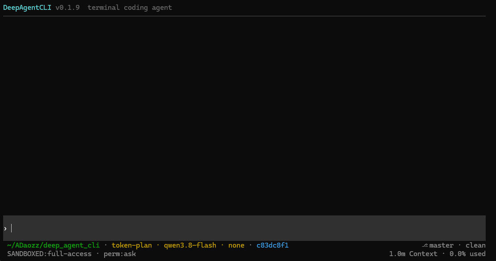
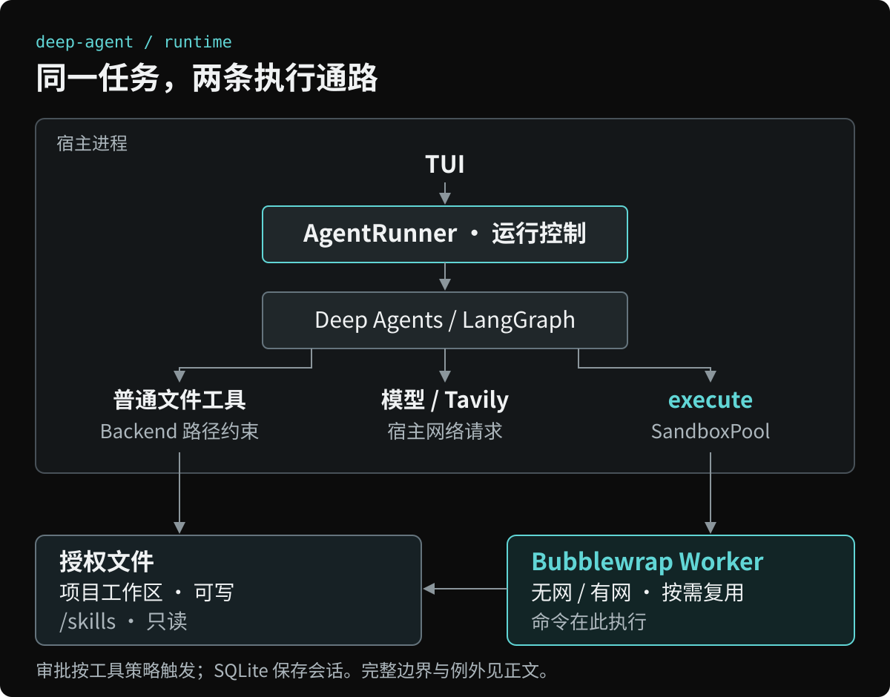

<div align="center">

# deep-agent-cli

**在终端中理解代码、审阅修改、运行命令。**

Linux / WSL2 · Python 3.12+<br>
OpenAI 兼容接口 · Bubblewrap

[快速开始](#快速开始) · [常用操作](#常用操作) · [架构与安全](#架构与安全) · [文档](#文档)

</div>

<p align="center">
  
</p>

`deep-agent` 是基于 [Deep Agents](https://github.com/langchain-ai/deepagents) 和 LangGraph 的终端 Coding Agent。它在当前项目中工作，默认在文件变更、命令执行和网页搜索前请求批准，通过 [Bubblewrap](https://github.com/containers/bubblewrap) 隔离命令执行。

在项目目录运行 `deep-agent` 进入交互式终端，用 `deep-agent resume` 恢复已有会话。要在其他 Python 程序里复用同一套运行核心，使用 [Python API](docs/library.md)。

> 当前版本 **0.1.9**，处于早期开发阶段。稳定版前，配置、会话存储格式和 Python API 可能出现不兼容变更。

## 能做什么

- **查代码、改文件** — 浏览、读取、正则搜索、编辑和删除；`Ctrl+R` 审阅完整改动，`F2` 处理审批。
- **运行项目命令** — 实时查看输出，会话内复用持久沙箱；默认审批、隔离直接 IP 网络。
- **随时介入任务** — 追加指令、排队后续任务、暂停、取消，以及结构化人工输入。
- **保留工作上下文** — SQLite 会话恢复、模型与推理强度切换、上下文压缩；支持图片输入的模型可接收附件。

支持通过 Skills 和 `AGENTS.md` 扩展项目指令。

## 快速开始

需要 **Linux / WSL2、Python 3.12+、Bubblewrap**，以及支持 Chat Completions 或 Responses 的模型端点。CLI 需要交互式终端；原生 Windows、macOS 和 WSL1 不支持这套沙箱。Ubuntu / WSL2 的 user namespace 限制见 [沙箱排查](docs/sandbox.md#排查ubuntu--wsl2)。

使用 Node 编写的 stdio MCP 服务或通过 `execute` 运行 Node 工具时，推荐 **Node.js 24（使用最新的 24.x 补丁版本）**；具体 MCP 服务仍以其自身的版本要求为准。

### 1. 安装

Debian / Ubuntu：

```bash
sudo apt install pipx bubblewrap
pipx ensurepath
# 重新打开终端后安装
pipx install deep-agent-cli
deep-agent --version
```

系统默认 Python 低于 3.12 时，使用 `pipx install --python /path/to/python3.12 deep-agent-cli` 指定已安装的解释器。ripgrep 随 Python 依赖安装，无需另行安装。

### 2. 初始化与配置

从项目目录启动，首次运行会创建 `~/.deep-agent/config.yaml` 和 Skills 目录，然后退出。已有配置不会被覆盖；设置了 `DEEP_AGENT_CONFIG` 时使用指定配置。

```bash
cd ~/projects/my-app  # 替换为你的项目目录
deep-agent
```

配置、Skills 和按键配置目录必须位于工作区之外，**不要将家目录或其上层目录作为工作区**。

默认模板是 `mode: restricted`，不预置工具挂载；需要 Node、Cargo / Rustup、Chrome、X11 或浏览器缓存时，按 [默认工具挂载](docs/configuration.md#默认工具挂载) 中的示例手动添加，可选源不存在时跳过。NVM 挂载整个版本目录后，使用哪个版本由用户在沙箱 `PATH` 中指定；程序不自动发现工具安装位置或选择版本。已有配置需手动对照模板合并，升级不会覆盖用户配置。

默认模板使用 `token-plan/qwen3.8-flash`。在启动 Agent 的同一个 Bash 终端中输入对应密钥：

```bash
read -rsp 'Token Plan API key: ' TOKEN_PLAN_API_KEY
export TOKEN_PLAN_API_KEY
printf '\n'
```

使用其他模型服务时，编辑 `~/.deep-agent/config.yaml`，调整端点、密钥、模型 ID 及能力配置。`api` 必须与端点匹配；省略时默认为 `responses`，不会自动判断。

<details>
<summary>查看模型配置示例</summary>

以下与默认模板一致；`llm.default` 使用“来源/模型”标识，模型项继承来源级字段，并可单独覆盖。

```yaml
llm:
  default: token-plan/qwen3.8-flash
  timeout: 60
  models:
    token-plan:
      base_url: https://token-plan.cn-beijing.maas.aliyuncs.com/compatible-mode/v1
      api_key: ${TOKEN_PLAN_API_KEY}
      api: chat_completions
      max_retries: 5
      stream_chunk_timeout: 120
      reasoning_efforts: [none, low, medium, xhigh]
      models:
        qwen3.8-flash:
          input: [text, image]
          context_window: 1m
```

端点、上下文窗口、输入模态和推理强度取决于所选服务，完整说明见 [配置参考](docs/configuration.md)。

</details>

### 3. 开始第一个任务

在项目目录再次运行 `deep-agent`，输入：

```text
阅读当前项目，列出程序入口、关键模块和测试命令，并注明对应文件。
暂不修改文件或执行命令。
```

获得项目概览后，可以继续要求一次小范围修改。默认 `ask` 下，文件变更会等待审批：`Ctrl+R` 查看改动，`F2` 打开审批面板。启动检查失败时默认拒绝进入宿主执行，见 [沙箱与权限](docs/sandbox.md)。

<details>
<summary>恢复会话、升级与虚拟环境安装</summary>

```bash
deep-agent resume           # 选择已保存的会话
deep-agent resume 01a08aae   # 换成已有会话的 ID 或前缀
pipx upgrade deep-agent-cli
```

恢复只加载状态，不自动继续未完成任务；旧数据库格式不自动迁移。取消不回滚已发生的文件修改或外部副作用。

不使用 pipx 时，也可安装到虚拟环境：

```bash
python3.12 -m venv ~/.venvs/deep-agent
~/.venvs/deep-agent/bin/pip install deep-agent-cli
~/.venvs/deep-agent/bin/deep-agent --version
```

</details>

## 常用操作

| 操作 | 用途 |
|---|---|
| `/model` | 切换模型与推理强度 |
| `Ctrl+R` / `F2` | 审阅文件改动 / 处理审批与提问 |
| `Enter` / `Alt+Enter` | 提交或运行中追加指令 / 排队后续任务 |
| `Esc` | 请求取消当前任务 |
| `Ctrl+O` / `Ctrl+T` | 展开工具输出 / 思考内容 |
| `/resume` / `/new` | 恢复或新建会话 |
| `/mcp` | 查看、开关和配置宿主 MCP 服务 |
| `/help` / `/status` | 查看完整操作与当前状态 |

更多按键、图片附件、队列、Skills 和显示设置见 [终端界面](docs/tui.md)。

## 架构与安全

**审批决定是否执行，隔离决定命令能访问哪些资源。** 文件工具和命令走不同通路：

- **文件工具 → 宿主进程**：Backend 使用工作区的真实绝对路径（如 `/mnt/d/test`），`/skills` 可写。`restricted` 下，启动时声明的额外挂载按同样的只读或读写属性授权；未声明路径拒绝访问。
- **命令 → Bubblewrap**：`execute` 经沙箱池运行，会话内按需复用有网、无网 Worker。模型与 Tavily 请求从宿主发送，不受命令网络策略约束。

<details>
<summary>展开运行架构图</summary>



SQLite 保存会话状态。模型工具表不包含 `grep` 和 `glob`。代码搜索和文件发现通过 `execute` 运行宿主提供、只读挂载进沙箱的 `rg`；搜索的审批与网络和其他命令相同。完整分层与生命周期见 [架构文档](docs/architecture.md)。

</details>

| 模式 | 审批 | 命令网络 |
|---|---|---|
| **沙箱 + `ask`**（默认） | 文件变更、命令、网页搜索、MCP 调用及增删服务需批准 | 默认隔离直接 IP 网络；`network=true` 获批后共享宿主网络 |
| 沙箱 + `allow` | 所有工具免审批，包括 MCP 工具、`mcp_add`、`mcp_remove` | 所有 execute 共享宿主网络 |

只读文件工具免审批；`/permission` 统一控制原生与 MCP 工具审批，`allow` 仅限沙箱模式。MCP 在宿主进程中运行，不经过 Bubblewrap，也不受沙箱网络策略限制。配置在 `~/.deep-agent/mcp.json`，根级 `enabled` 是全局开关（默认开启）；用 `/mcp`、`/mcp enable`、`/mcp disable` 或 `mcp_add` / `mcp_remove` 管理。全局关闭时不连接、不启动 stdio、不打开 OAuth，也不把 MCP 工具交给模型；配置和令牌缓存仍保留。**工作区内的 `.env`、`.git` 同样可访问，取消不回滚已发生的副作用。**

全局开关打开时，启动会自动连接各服务里 `enabled: true` 的项。OAuth 优先使用加密缓存并刷新令牌，无法刷新时打开浏览器授权；无需鉴权的服务直接连接。`/mcp` 先显示 `MCP: Enabled` 或 `MCP: Disabled`，开启时再列出 `服务名  状态  N tools`；`connected` 为绿色，其余状态为红色。连接恢复、附件处理和后台日志见 [MCP 配置](docs/configuration.md#mcpmcpjson)，命令和状态说明见 [TUI 文档](docs/tui.md#mcp-服务)。

<details>
<summary>更多边界与当前限制</summary>

- **网络与进程**：无网命名空间不阻断通过共享 Unix socket、FIFO 或文件实现的间接通信。有网实例可访问互联网、localhost 和局域网；切回 `ask` 不停止此前的后台进程。会话切换及关闭时清理沙箱。
- **挂载与资源**：用户可通过现有挂载列表扩大或缩小文件系统可见范围，审批逻辑保持独立。只读挂载仍允许读取其中的敏感文件。没有 CPU、内存、磁盘或进程数硬配额。Skills、`AGENTS.md` 和提示词不是操作系统安全边界。
- **本地状态**：同一会话只允许一个进程持有；工作区可能产生 `.deep-agent/` 命令日志和 `.deepagents/` 压缩历史，程序不修改 `.gitignore`。
- **客户端**：模型、MCP、Tavily 和子进程统一使用全局 [`trust_env`](docs/configuration.md#全局网络环境trust_env) 配置，默认忽略代理与 CA 环境变量；剪贴板图片仅支持 WSL，其他环境通过文件添加。MCP 支持 Streamable HTTP 和 stdio 工具调用及工具返回的内嵌资源；不提供独立 Resources / Prompts 接口、Sampling 回调、旧式服务端 Elicitation、MCP Apps UI 或子 Agent。

完整隔离范围与环境变量见 [沙箱与权限](docs/sandbox.md)。

</details>

## 文档

- **使用**：[配置参考](docs/configuration.md) · [终端界面](docs/tui.md) · [正则搜索](docs/search.md)
- **机制**：[沙箱与权限](docs/sandbox.md) · [架构设计](docs/architecture.md)
- **集成**：[Python API](docs/library.md) · [开发指南](docs/development.md)

<details>
<summary>扩展 Skills 与网页搜索</summary>

Skills 位于 `~/.deep-agent/skills/<技能目录>/SKILL.md`，使用 `/skill` 选择；配置 Tavily key 后启用 `web_search`。外部工具与浏览器需预先安装并通过沙箱挂载，见 [Skills 用法](docs/tui.md#skills) 与 [沙箱工具链](docs/sandbox.md#playwright-与有头-x11)。

</details>

<details>
<summary>从源码开发</summary>

```bash
git clone https://github.com/ADaozz/deep_agent_cli.git
cd deep_agent_cli
python3.12 -m venv .venv
source .venv/bin/activate
pip install -e ".[dev]"
pytest -q
```

自动化测试不调用真实模型；CI 覆盖 Python 3.12 和 3.13。更多说明见 [开发指南](docs/development.md)。

</details>

[MIT License](LICENSE)
