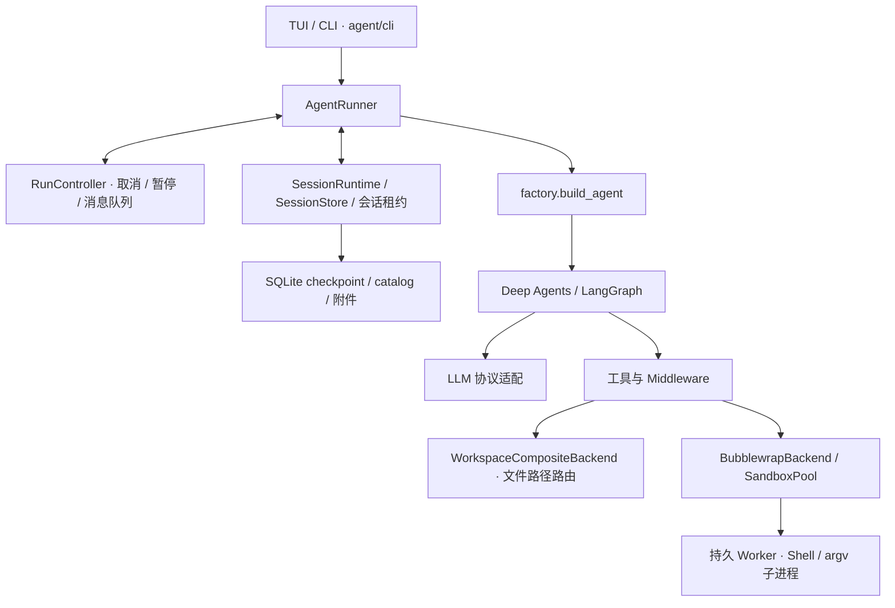
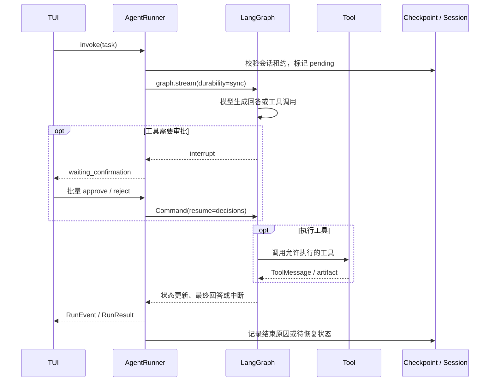

# Harness 架构

`deep_agent_cli` 使用 Deep Agents 和 LangGraph 执行 Agent 图。Harness 负责将模型、工具、工作区、人工干预、沙箱、会话和终端界面组织成可控制、可恢复的运行系统，不另行实现推理循环。使用入口是交互式 CLI；嵌入其他 Python 程序时走 [Python API](library.md)。

本文描述当前实现与扩展边界。配置和操作说明见 [README](../README.md)、[沙箱与权限](sandbox.md)；Python 接入见 [library.md](library.md)。

## 职责与设计约束

Harness 的职责包括图装配、运行控制、工具审批、命令隔离、状态持久化和终端事件转换。其中有几个需要始终分开的概念：

- 模型提出工具调用，Harness 按既定策略决定是否执行，以及在哪里执行。
- 权限模式决定调用前是否审批；沙箱决定执行进程能访问的资源。提示词、`AGENTS.md` 和工具描述不承担操作系统安全边界。
- 不同模型工具可以共享执行资源。`execute` 按有网和无网实例复用沙箱，并保留自己的参数、输出与审批语义。
- 取消不回滚已经发生的文件写入或外部副作用；Worker 失效不自动重放正在执行的命令。
- 同一会话的模型、权限切换复用沙箱；新建、切换和关闭会话清理原会话的沙箱。

当前没有启用子 Agent 或 MCP 客户端，也没有容器编排、CPU、内存、磁盘或进程数的硬配额。这些不属于现有 Harness 的能力承诺。

## 分层



文件与进程是两条不同的访问通路：普通文件工具在宿主 Python 进程中通过 Backend 访问授权路径；Shell 命令在 Bubblewrap 内运行。模型工具表不包含 `grep` 和 `glob`。代码搜索和文件发现通过 `execute` 调用沙箱 `PATH` 上的 `rg`。

| 层 | 实现 | 职责 |
|---|---|---|
| 交互入口 | `agent/cli/` | 输入、渲染、审批与提问界面 |
| 运行控制 | `agent/runner.py`、`control.py` | Run 生命周期、中断恢复、取消、steering、统一事件 |
| 图装配 | `agent/factory.py`、`middleware/` | 工具、中间件、Backend 与 Deep Agents 的接线 |
| 模型适配 | `agent/llm.py`、`llm_stream.py`、`stream.py` | API 协议、思考流、工具调用、附件与 usage |
| 工具 | `agent/tools/`、上游文件工具 | Schema、参数校验、结果与 artifact |
| 文件与执行环境 | `agent/sandbox.py`、`sandbox_pool.py`、`sandbox_worker.py` | 工作区真实路径、命名空间、持久进程、超时与清理 |
| 会话状态 | `agent/session.py`、`session_runtime.py`、`session_lock.py` | Checkpoint、元数据、附件、独占租约与恢复 |

核心 Runtime 不依赖终端格式；`RunEvent` 不带 ANSI 样式，由 TUI 转换和展示。

### 状态文案设计规范

工具卡片和聚合摘要的状态标题统一遵循：**运行中使用进行式（`-ing`），成功完成后使用过去式；等待、失败、取消及完成未确认时不使用成功文案。** 新增或调整状态展示时沿用此口径。

| 操作 | 运行中 | 成功完成后 |
|---|---|---|
| 命令执行 | `Running <命令>` | `Ran <命令>` |
| 编辑文件 | `Editing <路径>` | `Edited <路径>` |
| 写入文件 | `Writing <路径>` | 根据结果显示 `Created <路径>` 或 `Wrote <路径>` |
| 删除文件 | `Deleting <路径>` | `Deleted <路径>` |
| 探索分组 | `Exploring N items` | `Explored N items`（单项用 `item`） |

- **以执行状态为依据**：收到工具开始事件后才显示进行式；成功文案只依据成功的工具结果，不能从已有输出、拟议改动或整轮任务结束推断。新建与覆盖依赖结果中的 `artifact.operation`；旧结果缺少该字段时保留中性 `write`，不猜测为新建。
- **等待与异常单独表达**：等待执行使用中性动作名和 `waiting for input`；完成未确认使用 `interrupted (completion unconfirmed)`。命令失败、超时、取消、启动失败分别显示 `Failed`、`Timed out`、`Cancelled`、`Failed to start`，不使用 `Ran`。
- **聚合状态覆盖全部成员**：探索分组有正在运行的成员时显示 `Exploring`；无运行成员但存在等待、失败或中断时使用中性 `Explore`，附带等待提示或失败、中断计数。仅全部成功后使用 `Explored`。成功的连续新建合并为 `Created N files`。
- **区分动作标签与状态标题**：工具名、审批动作和探索明细中的 `Read`、`Search`、`List` 等动作标签不承担完成状态；成功与否由状态标题、标记及异常提示表达。
- **视图一致**：折叠、展开、输出流刷新和历史恢复使用同一状态语义；测试覆盖从开始到成功的切换，以及等待和异常状态，防止过早显示完成。

## 构图

`factory.build_agent()` 是统一的图装配入口，调用上游 `create_deep_agent()`；`create_agent()` 是便捷入口。`AgentSpec` 描述 instructions、扩展工具、Skills、Backend、沙箱配置和搜索密钥；`PreparedAgent` 保存图、模型、工具注册信息、审批规则、checkpointer、控制器和 SandboxPool 等装配结果。

### 工具注册

| 工具 | 来源与条件 | 默认 `ask` 下的交互 |
|---|---|---|
| `ls`、`read_file` | Deep Agents 文件系统中间件 | 免审批 |
| `write_file`、`edit_file`、`delete` | Deep Agents 文件系统中间件 | 执行前审批 |
| `execute` | Backend 支持命令执行时注册 | 每次审批 |
| `web_search` | 配置 `TAVILY_API_KEY` 或 `web_search.tavily_api_key` 时注册 | 每次审批 |
| `request_human_input` | 始终注册 | 独立的人工输入中断 |
| `compact_conversation` | `SummarizationToolMiddleware` | 上下文压缩工具 |
| `extra_tools` | 调用方显式注入 | 有副作用的工具需显式加入审批规则 |

`web_search` 是可用的内置工具，有密钥时正常提供，未配置时不注册。其 Tavily 请求在宿主进程中发送，不受 Shell 的网络命名空间约束。

文件工具由 `WorkspaceFilesystemMiddleware` 提供。它用相同中间件名称替换上游的 `FilesystemMiddleware`，修正 Composite Backend 的执行能力判断，使单独注册的 `execute` 仍对模型可见。注册给模型的文件工具只有 `ls`、`read_file`、`write_file`、`edit_file` 和 `delete`，不包含 `grep` 或 `glob`。

Harness Profile 禁用默认 general-purpose 子 Agent，因此没有 `task` 工具。Todo 工具及配套状态、事件、Plan 展示已移除，没有 `write_todos`。

### Middleware

传给 Deep Agents 的项目中间件按以下顺序排列；上游仍负责自身默认中间件与图执行机制。

| 中间件 | 控制位置与作用 |
|---|---|
| `RuntimeConfigGateMiddleware` | 下一次模型调用前处理待生效的模型/权限切换 |
| `PauseGateMiddleware` | 下一次模型调用前响应暂停 |
| `RecoveryContextMiddleware` | 异常恢复后的首次模型请求附加说明，不写入 checkpoint |
| `UsageIdentityMiddleware` | 模型响应进入 checkpoint 前标记来源 |
| `SteeringMiddleware` | 注入运行中指令，必要时撤销尚未执行的工具提议并重新推理 |
| `ToolCancelMiddleware` | 为工具传递可取消上下文 |
| `ToolArgHintMiddleware` | 为工具参数校验错误提供提示 |
| `WriteOperationMiddleware` | 标记 `write_file` 是新建还是覆盖 |
| `AttachmentMaterializationMiddleware` | 仅请求模型时将图片引用展开为内容 |
| `WorkspaceFilesystemMiddleware` | 文件工具及组合 Backend 能力适配 |
| `SummarizationToolMiddleware` | 提供手动压缩工具 |

工具审批通过 `interrupt_on` 交给 Deep Agents HITL，不在各工具内部重复实现审批流程。

## 运行与中断



`AgentRunner._stream()` 驱动图，使用 `stream_mode=["updates", "values"]` 和 `durability="sync"`。它把模型与工具消息转成 `RunEvent`，负责运行边界、待生效配置、恢复与后续消息。流式回答和思考通过既有流回调转发。

`RunResult` 的状态包括 `completed`、`failed`、`cancelled`、`waiting_confirmation`、`waiting_human`、`paused` 和 `runtime_config_boundary`。几类中断含义不同：审批是执行前授权；人工输入是 Agent 提问；暂停是用户请求；配置边界用于安全切换模型或权限。它们借助 checkpoint 恢复，但不能互相替代。

### 运行中控制

- `steer(text)` 在模型安全边界介入；模型刚生成但尚未执行的工具提议可以被丢弃，随后重新推理。
- `follow_up(text)` 排在当前任务后执行，不抢占活动工具。
- 暂停和排队的模型/权限修改在下一次模型调用前处理；切到 `allow` 不会自动同意已经等待中的审批。
- 用户追加的消息不被当作工具审批的同意。

`RunController` 按运行代际隔离取消信号，也处理已经调度但尚未 `begin_run` 的取消。取消会关闭模型流、请求图停止，并通知活动工具。`execute` 最终终止本条命令的进程组，正常情况下保留持久沙箱。

最终回答已经 checkpoint 后到达的取消，不把完成结果改写为取消。文件写入、外部请求等已经发生的副作用不会回滚；失败后需要核对 checkpoint 与实际工作区状态。

## 权限与执行模式

| 概念 | 决定什么 | 实现位置 |
|---|---|---|
| `ask` / `allow` | 工具调用前是否审批 | `agent/permission.py`、Deep Agents HITL |
| `SANDBOXED` / `CUSTOM` | 进程在哪里运行、由谁隔离 | Backend 选择与沙箱配置 |
| `restricted` / `full-access` | 沙箱文件系统可见范围 | `SandboxConfig.mode` 与 Bubblewrap 挂载 |
| `execute.network` | 选择有网或无网实例，受权限模式约束 | execute、网络上下文与 SandboxPool |

`ask` 默认审批文件修改、每次 `execute` 和每次 `web_search`。`ls`、`read_file` 等只读文件工具免审批；通过 `execute` 调用 `rg` 的代码搜索仍需审批。`allow` 只在已知的 `SANDBOXED` 模式可用，免除工具审批，并使所有 execute 使用有网实例，即使参数为 `network=false`。`ask` 下的 `execute(network=true)` 仍需审批，获批后进入有网实例。

找不到 `bwrap` 时启动失败，没有宿主机执行回退。`CUSTOM` 由调用方注入的 Backend 决定资源边界。`restricted` 与 `full-access` 只改变文件系统挂载，不改变审批，也不提权。`/sandbox` 在下一次模型调用前更换挂载并关闭当前会话的两个沙箱；模式不写入会话库，恢复会话时回到配置文件中的 `sandbox.mode`。

## Backend 与路径

`WorkspaceCompositeBackend` 将模型看到的路径路由到授权根。工作区路径是宿主目录的真实绝对路径。路由在 Backend 初始化时固定，运行中不能新增挂载：

以下以工作区 `/mnt/d/test` 为例。两种模式使用同一条真实路径。

- `/mnt/d/test` → 工作区。普通文件操作由其 `FilesystemBackend` 能力在宿主执行；命令经 `BubblewrapBackend` 启动。
- `/skills` → 可写 Skills Backend，使用 `~/.deep-agent/skills/`（目录不存在时创建）。
- `sandbox.extra_read_write_mounts` 与 `extra_read_only_mounts` 的目标 → 对应宿主目录或单个文件。目录复用 `FilesystemBackend`；只读目录在写入前拒绝；单文件只匹配该路径。
- `restricted` 下，工作区、`/skills` 和声明挂载之外的路径 → 拒绝访问。`/home` 与 `/tmp` 不作为文件工具路径，命令通过沙箱挂载访问那两个持久目录。
- `full-access` 下，未命中更具体路由的路径走以 `/` 为根的文件系统。安装路径只读，配置目录及目录外的配置文件返回 Permission denied。`ls('/')` 列出真实根目录子项，并补上 `/skills` 这类沙箱顶层挂载。

Bubblewrap 在 `restricted` 下内置的系统运行时挂载（`/usr`、`/lib` 等）不进入文件工具路由。重复目标、后挂载盖住先挂载或错位嵌套在初始化时失败。同一宿主目录的只读和读写别名按各自路径分别授权。文件工具不能删除挂载点，也不能顺着符号链接删掉链接背后的文件，或绕过配置目录与安装目录保护。`/sandbox` 会按新模式刷新这张路由，工作区路径保持不变。

工具挂载由配置直接声明，没有工具链自动发现或版本选择层。默认模板将 NVM 的整个版本目录挂到 `/opt/node`，版本由用户在 PATH 中指定；Cargo 和 Rustup 分别挂载为 `/opt/cargo`、`/opt/rustup`；Chrome 程序只读，浏览器缓存单独可写。可选源不存在时在配置加载阶段跳过。模板的具体路径及环境变量见 [默认工具挂载](configuration.md#默认工具挂载)。用户扩大或缩小挂载范围不改变审批策略；只读挂载仍允许读取其中的敏感内容。

`artifacts_root` 为 `<工作区真实路径>/.deepagents`，用于压缩历史等上游产物。文件工具的访问边界来自 Backend 路径约束，不能描述为所有读写都在 Bubblewrap 内。`.git/`、`.env` 等文件若在授权工作区内，也在 Agent 可访问范围内。

### 双持久沙箱

一个会话按需保有 offline 和 online 两个 Bubblewrap 实例，每个实例以常驻 Python Worker 为主进程。`SandboxPool` 负责懒启动、复用、失效替换与会话清理；`PersistentSandbox` / `RemoteCommand` 通过控制管道、request ID 和输出事件管理每条命令。

每次 `execute` 启动新的 `/bin/sh -lc`，Shell 变量和 `cd` 不跨调用保留；实例内 `/tmp`、`/home` 文件以及仍存活的后台进程可以保留。有网和无网实例绑定同一组 `/tmp` 与 `/home`：`restricted` 是专用持久目录，`full-access` 是当前环境的真实目录。切换回 `ask` 不会停止此前有网实例中的后台进程。`/sandbox` 会关闭两个实例。

模型或权限切换复用当前 Pool。新建、切换、关闭会话会清理原 Pool，不能把旧会话的后台状态带入新会话。Worker 丢失时当前调用明确失败、不自动重放，下一次调用可以创建替代实例。

### 文件系统隔离与环境生命周期

文件系统模式划定执行环境能看见哪些路径，不负责管理用户开发环境的生命周期。权限隔离、环境持久化、环境独立性和工具审批是分开的：

1. **权限隔离**：`restricted` 使用受限文件系统视图；`full-access` 在当前用户的操作系统权限内访问真实文件系统。
2. **环境持久化**：`HOME` 和 `TMP` 落在持久目录上，不跟着 Bubblewrap 进程一起消失。
3. **环境独立性**：两种模式默认使用不同的 HOME，不要求用户级安装结果互相可用，也不自动复制或迁移。
4. **工具审批**：`ask` / `allow` 只决定调用前要不要批准，不决定 HOME、工作区或系统目录怎么挂。

`restricted` 的持久 HOME（`~/.deep-agent/sandbox/home`）是沙箱运行数据，不是 Agent 配置或凭据目录。`full-access` 使用宿主机真实家目录。路径和切换时能观察到的行为见 [sandbox.md](sandbox.md#home-隔离与持久化)。

`/sandbox` 让 `SandboxPool` 结束当前实例，并在下次执行时按新挂载重建。已经写下的环境文件不删除。视图变了，不表示文件被搬走。

跨模式只约定这些事：两种模式看到同一条工作区绝对路径；每种模式自己的持久 HOME 可以在沙箱重建和 Agent 重启后继续用。不约定用户级 Python 包、全局工具或环境变量在两种模式里一致。出厂配置只提供上述最小基线，不代替部署方对可见目录和敏感路径的声明。显式挂载和环境变量可以扩大共享范围，但不能改写 Agent 安装目录和配置目录上的自保护。具体调整见 [sandbox.md](sandbox.md#文件系统模式)。

### 线程环境快照

固定系统提示在构图时生成，不包含环境快照。`EnvironmentContextMiddleware` 在每次模型调用时，把当前沙箱的短快照附到这条系统提示后面，不写入 checkpoint 的消息。快照描述这次 `execute` 会进入的沙箱，不描述 `read_file` 等文件工具的宿主访问范围。额外挂载只列沙箱内目标路径和 `ro`/`rw`，不写宿主源路径；超过 8 条时只列前 8 条并标出剩余数量。同一沙箱指纹下复用探测结果。`ask` / `allow` 只更新审批和网络。`restricted` / `full-access`，或工作区、HOME、额外挂载变化后，下一次模型调用重新采集受影响的字段。恢复会话时丢掉内存里的旧快照，下一次模型调用按当前沙箱重新检查。已给出的字段直接使用，不要再查。

采集使用与 `execute` 相同的离线挂载做一次只读探测，不经过工具审批，也不扫描软件包、进程、CPU 负载或内存。探测失败的字段为 `unknown`，不中断线程。这里没有新的配置项。

### 隔离边界

默认工作区和 `/skills` 可写。`restricted` 下系统运行时目录只读，`/tmp` 与 `/home` 是 `~/.deep-agent/sandbox/` 下的持久目录；工作区仍通过它的真实绝对路径挂载。`full-access` 映射当前文件系统，并把 Agent 安装目录重新挂成只读、用权限 `000` 的 tmpfs 遮住配置目录。沙箱使用独立 PID、IPC、UTS namespace，无网实例另有 network namespace。环境变量按配置白名单传入，额外挂载和环境设置会影响实际可访问范围。完整挂载与配置见 [sandbox.md](sandbox.md)。

无网实例阻断直接 IP 网络访问，不承诺阻断一切间接联网；共享工作区中的 Unix socket、FIFO 或普通文件可能成为通信通道。当前也没有资源硬配额。部署边界以 [sandbox.md](sandbox.md#网络) 为准，不能靠提示词补足。

## grep 搜索

`grep` 和 `glob` 不在模型工具表中。模型用 `execute` 运行 `rg -n` 和 `rg --files -g`；这条命令的审批、网络和持久沙箱与其他 `execute` 相同。代码里仍保留本地搜索实现，参数为 `pattern`、`path`、`glob`、`output_mode`、`max_count`、`fixed_string`。默认正则，`fixed_string=true` 时按字面量匹配；`glob` 支持单条或多条规则及否定规则。该实现没有 Shell 字符串或 `network` 参数，不调用 `execute` Tool 或 `backend.execute`。

```text
参数与 Glob 校验
  → WorkspaceCompositeBackend.regex_search_location() 按固定挂载表路由路径
  → 宿主以 O_NOFOLLOW 和文件描述符校验挂载根、目标与文件限制
  ├─ Bubblewrap 且有 rg
  │    → SandboxPool → start_argv → 原 Worker → 单个 rg
  └─ 无 rg，或执行器不是 Bubblewrap
       → 独立宿主 Python Worker → 目录描述符遍历与 re 匹配
  → 流式解析、计数、去重、截断 → 工具结果
```

`ripgrep-bin` 随 Python 依赖安装。`resolve_rg()` 与用户侧参数、Glob、ignore、结果限制见 [search.md](search.md)。

沙箱启动时将宿主 `rg` 只读挂载到 `/run/deep-agent/rg`，持久 Worker 与一次性命令共用这套挂载。自定义或继承 PATH 后仍将 `/run/deep-agent` 放在最前。`ask` 的无网实例和 `allow` 的有网实例挂载同一份二进制，模型直接执行 `rg`。宿主找不到 `rg` 时不挂载该路径，并在启动日志中说明 `rg` 不可用。上面保留的搜索实现在没有 `rg` 或执行器不是 Bubblewrap 时使用宿主 Python worker；有 `rg` 时仍通过 `start_argv` 调用 `/run/deep-agent/rg`，与相同网络模式的 execute 共享 Worker，没有独立 grep 沙箱。

`start_argv()` 使用现有控制管道和命令生命周期。Worker 通过 `Popen(argv, shell=False)` 启动 rg，分别转发 stdout/stderr；原 Shell 入口仍合并输出。Worker 再次以 `O_NOFOLLOW` 打开路径并核对挂载根 inode，单文件通过已打开的文件描述符交给 rg，防止校验后替换路径。

**常驻的是沙箱和 Worker，rg 每次搜索启动、结束后退出。** 搜索结束、取消、超时或截断只清理本条 rg；Worker 失效则沿用 Pool 的丢失与替换机制。搜索总预算 10 秒，包含 Pool 等待和冷启动。

Python 回退是独立、可强制终止的宿主进程，依靠描述符遍历限制文件访问，不具备 Bubblewrap 隔离。Python `re` 与 Rust Regex、ignore 解析的差异见 [search.md](search.md)；不通过静默字面量匹配掩盖。

## 模型适配

`llm.build_chat_model()` 按配置的 `api` 选择协议，而非按模型厂商分支：

- `responses` → `ResponsesChatOpenAI`。将已知非标准 `response.reasoning_text.*` 事件规范化为 LangChain 支持的 `response.reasoning_summary_text.*`，标准事件继续由上游解析。
- `chat_completions` → `ChatCompletionsChatOpenAI`。兼容 `reasoning_content` / `reasoning`，统一保存思考正文，并保留来源字段名用于历史回传。

两者继承 `ProtocolChatOpenAI`，统一同步/异步 HTTP 客户端、超时、重试、请求序列化和附件解析。Responses 继续复用 LangChain 的完整解析循环、工具调用拼接与异常映射；SDK 的结构化 parse 与 create 路径共用 usage 规范化。模型客户端统一使用协议类名，不保留旧厂商别名。

图片在 checkpoint 中保存附件引用，仅模型请求时展开。`agent/stream.py` 将思考与正文分开，也处理正文中的 `<think>…</think>` 标签。

`UsageIdentityMiddleware` 标记模型来源，流式回调将 usage-only chunk 转成既有事件。界面以 API 返回的 `input_tokens` 展示占用，缺失时显示 Unknown，不将估算数当成实际用量；取消、切换和压缩时清除旧值，恢复只读取当前来源的有效 usage。配置 `context_window` 时写入模型 profile 的 `max_input_tokens`。

新增兼容 Responses / Chat Completions 的模型应优先只改配置。非标准端点兼容局限在适配层，Runner、工具、会话与沙箱继续消费统一消息和事件。

## 上下文压缩

自动压缩使用 Deep Agents 的 `SummarizationMiddleware`：有 `max_input_tokens` 时约在窗口 85% 触发，保留最近约 10% 上下文；没有该 profile 信息时，约 170,000 tokens 触发，保留最近 6 条消息。具体阈值取决于上游版本。

`/compact` 调用 `AgentRunner.compact_context()`，在图内执行 `compact_conversation`，要求 usage 达到自动阈值的一半。压缩历史以 Markdown 保存到 `<工作区真实路径>/.deepagents/conversation_history/<id>.md`，之后仍可读取。升级上游时需重验触发条件和历史存储契约。

## 会话存储

默认每个工作区对应 `~/.deep-agent/sessions/` 中的一份 SQLite 数据库；作为库使用且未传入持久 checkpointer 时，工厂使用 `InMemorySaver`。持久会话包含：

- LangGraph `SqliteSaver` checkpoint：消息、图状态、中断；禁用 pickle fallback。
- `session_catalog`：标题、时间、模型、推理强度、权限、待切换配置和上轮结束原因。数据库使用 WAL、权限 `0600`，仅接受当前表结构，不自动迁移旧数据库。
- `<db>.locks/`：每 thread 一个 `flock` 独占租约，退出时由内核释放；锁文件保留，描述符 close-on-exec。
- `<db>.attachments/`：按内容哈希保存的图片附件。

`SessionRuntime` 负责租约、新会话延迟持久化、会话切换和恢复计划。切换先读取和准备目标，再提交绑定；读取失败保留原会话。尚在写 checkpoint 的运行不能提前失去租约。

上一轮 `pending` 且已有 checkpoint，或以 `aborted` / `error` 结束时，下一次用户输入会附加一次性恢复说明。明确的审批、人工输入、暂停中断按各自 checkpoint 恢复，不重新生成或自动重放未知结果的工具。持久化图状态不等于恢复沙箱进程；会话重新打开时按需启动新沙箱。

## 终端界面

TUI 使用 Runner 的公开操作和结构化事件，负责终端输入、展示、审批、提问及选择器。操作与显示见 [tui.md](tui.md)。

## 观察与验证

诊断以结构化运行事实为依据：Run 状态和终态、模型来源及实际 usage、tool call ID/参数/结果/artifact、审批快照与决定、命令退出原因、沙箱网络模式与 Worker 状态。超限 execute 输出另存 `<工作区真实路径>/.deep-agent/logs/exec/`，工具结果提供日志路径。工具输出是外部内容，不能改写审批或沙箱策略。

| 行为契约 | 相关测试 |
|---|---|
| 工具注册、审批、拒绝与权限切换 | `test_runner.py`、`test_permission.py`、`test_web_search.py` |
| 正则、Glob、结果限制、回退、路径边界和搜索取消 | `test_grep.py` |
| 双沙箱复用、argv/Shell、网络模式、超时及 Worker 失效 | `test_sandbox.py`、`test_persistent_sandbox.py` |
| 运行中消息与模型流取消 | `test_steering.py`、`test_model_stream_cancel.py`、`test_streaming_cancel.py` |
| 会话持久化、租约与切换 | `test_session.py`、`test_session_lock.py`、`test_session_switch.py` |
| 模型协议、usage 与附件 | `test_llm.py`、`test_protocol_api.py`、`test_attachments.py` |

运行方式见 [development.md](development.md)。报告测试时区分 Mock、本地模拟模型端点、真实 Bubblewrap、浏览器及真实模型调用；本架构文档不作为某次测试已通过的证明。工具注册测试需显式控制 Tavily 配置，终端渲染测试需明确 TERM，避免把环境差异当作运行时回归。

## 扩展边界

新增工具应明确 Schema、副作用、审批、路径权限、超时/取消、输出上限与失败行为，并复用现有注册和运行控制。实现调用进程并不意味着应合并为 `execute`。未来接入 MCP 时，还需明确远程请求实际发生的位置与授权上下文，不能声称它自动受到 Bubblewrap 保护。

增加并行执行前需规定 checkpoint 写入所有权、副作用一致性、取消竞态和终态；提高隔离级别前需定义部署威胁模型、间接通信与资源配额要求。终端和库调用方以既有 RunResult 和 RunEvent 为契约，不自行推断审批已生效或取消已完成。这些是扩展时的设计要求，并非当前已有功能。

## 依赖

主要依赖范围见 [pyproject.toml](../pyproject.toml)。`deepagents>=0.7.17,<0.8.0`、`langchain-openai>=1.6.2,<1.7.0` 的部分内部接口用于协议适配、文件系统能力和压缩；升级需针对这些契约回归验证，不以修改上游源码或建立平行执行引擎替代。

## 源码入口

- 图与运行控制：[factory.py](../agent/factory.py)、[runner.py](../agent/runner.py)、[control.py](../agent/control.py)、[permission.py](../agent/permission.py)。
- 文件与进程：[sandbox.py](../agent/sandbox.py)、[sandbox_pool.py](../agent/sandbox_pool.py)、[sandbox_worker.py](../agent/sandbox_worker.py)、[grep.py](../agent/tools/grep.py)、[execute.py](../agent/tools/execute.py)。
- 会话与模型：[session.py](../agent/session.py)、[session_runtime.py](../agent/session_runtime.py)、[session_lock.py](../agent/session_lock.py)、[llm.py](../agent/llm.py)。
