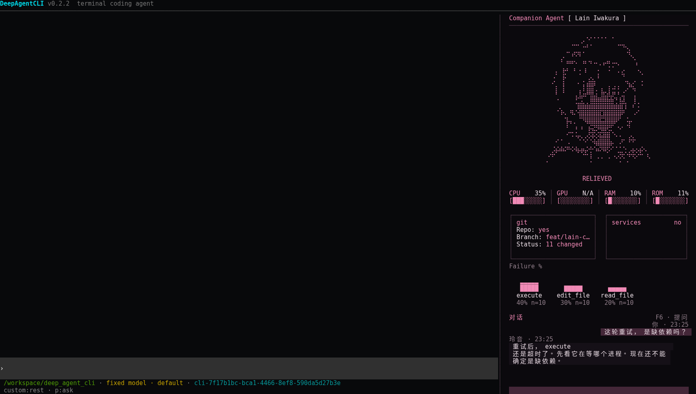
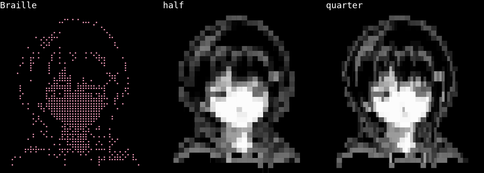

# Lain Companion 使用与验收

侧栏占终端总宽度的 28%，最低显示尺寸为 120 列 × 32 行。F6 在主输入和 Lain 输入之间切换，Enter 发送，Esc 返回主输入。也可在主输入中使用 `/lain 最近的失败集中在哪些工具？`。聊天和图表分别支持鼠标滚轮，F7 翻看下一组工具。切换会话会清空聊天草稿并恢复该会话的统计。ROM 表示工作区所在文件系统的已用容量百分比。



## 从事件到复盘

- 主运行发布 Run 和 Turn 身份，UI 在线程切换之前捕获模型、推理档位、实际时间和单调时钟。子 Agent 从发起委托的作用域继承父会话与轮次，并携带自己的身份、模型及档位。工具结果关联开始事件上的身份。
- SQLite 使用 WAL 和批量事务。工具开始、结束共享执行记录的幂等键。资源约每 2 秒采样，Git 复用已有的 5 秒探针，服务变化独立入库。按会话保存统计窗口、异常、分析结果及轮次摘要。窗口排名在内存更新，磁盘查询和 GIF 转换在 UI 线程之外运行。
- 关闭或切换会话会尝试提交缓冲区。异常退出后，已提交但没有结束事件的调用显示为 unknown。后续收到对应完成事件时可更正结果，跨进程的单调耗时保留为空。未提交的最后一批可能丢失。
- 默认每种工具保留最近 20 个具有明确成功或失败结果的调用。环境变量 `LAIN_FAILURE_WINDOW` 可设为 1–500。分母为 success + failed，cancelled 和 unknown 分别计数。累计和窗口百分比均保留。在当前会话、模型、推理档位内，最近窗口达到 15% 才绘图。所有符合条件的工具可以分页查看，柱子按窗口失败率从左到右降序排列，同率按工具名排序。柱下显示工具、失败率和样本量。带时间戳的窗口点继续落库。
- 工具和模型整体分别判断异常。基线至少 5 个旧样本、窗口至少 5 个样本，窗口失败率达到 25% 且比旧基线高至少 20 个百分点时触发。单工具连续 3 次同类错误也可触发。另有跨工具、跨模型的会话总体检测：最近 200 个明确结果按调用次数加权，对比不重叠的历史基线。两组各至少 40 个样本、近期至少 4 次失败、上升至少 5 个百分点且差异达到 2 个合并标准误时触发。因此 20 种工具各从 0% 升到 10% 也能产生会话异常，图表可以保持空状态。推测重试使用同一运行中、同一工具在前次失败后 60 秒内再次开始的关系；它不能确认调用意图。
- 新异常获得独立身份和证据版本，提交分析申请后才向模型发送异常摘要。触发条件消退后，还需至少 5 次连续成功；有历史基线时，窗口失败率须回到开启时基线的 5 个百分点内，才记录恢复。每种异常从开启时起有 120 秒冷却。普通采样、服务变化和常规轮次结束只做本地计算。主动提问及主动要求复盘使用同一个 Companion 模型入口。
- 轮次摘要关联模型、档位、各工具的调用结果、耗时、成功率、起止窗口失败率、可能的重试、资源与 Git 起止状态、异常及前三轮耗时。使用 `/lain stats` 可直接查看最近一轮工具次数、耗时和成功率，无需模型。用户可以在聊天框输入“复盘上一轮”。本地筛选趋势、同类重试、失败附近的高资源占用和 Git 变化、恢复证据与显著耗时差异。提供给玲音的复盘视图只含有解释价值的发现。玲音用一至三句中文回答；主动观察通常一句。证据不足时保留疑问。模型离线时统计和图表仍可使用。
- 存储按工作区分库，查询按会话过滤。每分钟清理 14 天以前的记录，并将时间序列裁到最近 100,000 条。累计统计恢复的范围受保留期约束。旧版工具记录缺少推理档位，迁移后归入 unknown。一次本地压测写入 100,050 条模拟采样并清理，耗时 0.77 秒，余 100,000 条，数据库约 13.0 MiB。随后 30 次单样本事务的中位耗时为 0.80 ms，P95 为 1.33 ms。

## 权限和诊断数据

模型通过宿主 RPC 列出、搜索或读取当前工作区的源文件，并查询当前会话的统计、近期失败、可能重试、时间线、Git 和摘要。仓库内容及工具结果均作为数据提供。每次请求绑定会话、请求序号和随机令牌，宿主在访问前和返回后校验；切换会话使旧查询和回复失效。异常自动分析只接收相关摘要，仓库工具仅用于用户提问路径。

文件接口只接受相对路径和受支持的文本类型，拒绝隐藏路径、敏感命名、受保护的配置位置、跨挂载点、符号链接、多重硬链接及非普通文件。宿主校验文件描述符后读取同一 inode。内容检查会屏蔽已知密钥和可识别的凭据形式；仓库中任意伪装成普通文本的未知秘密无法靠模式穷尽识别。工具没有写入、删除、执行 Shell 或调用主 Agent 工具的接口。发送给 Companion 模型的代码摘录受这些限制约束。

单个文件上限 256 KiB，每次读取最多 16 行。搜索至多检查 3,000 个条目、约 8 MiB 文本、1.5 秒，返回最多 12 条命中。宿主 RPC 另有超时及字符上限。遥测库保存失败分类与退出码；命令参数、原始输出、聊天正文和模型推理不落库。进程内保留少量经过脱敏的近期错误摘要供用户提问。

## GIF 对比



实测使用 Debian 13 x86-64、timg 1.6.0、仓库内 `lain_idle.gif` 的完整 38 帧。Braille 经过 prompt_toolkit 差分绘制，timg 经过自身的终端输出。每种模式运行一个新进程、播放一轮，包含解码和冷启动。表中 RSS 为整个渲染进程的峰值，帧间隔由输出控制序列的到达时间测量。结果代表本机这次测量。

| 视口 | 渲染器 | CPU 秒 | 峰值 MiB | 输出字节 | 绘制字符数 | 帧间隔中位 / P95（ms） |
|---|---|---:|---:|---:|---:|---:|
| 28×16 | Braille | 0.65 | 46.1 | 16,284 | 1,438 | 126 / 155 |
| 28×16 | half | 1.08 | 201.8 | 129,311 | 4,356 | 120 / 121 |
| 28×16 | quarter | 0.81 | 201.8 | 146,933 | 4,810 | 120 / 121 |
| 21×12 | Braille | 0.56 | 45.8 | 10,721 | 843 | 126 / 137 |
| 21×12 | half | 0.87 | 201.8 | 84,250 | 2,863 | 120 / 122 |
| 21×12 | quarter | 0.58 | 201.7 | 99,371 | 3,245 | 120 / 124 |

quarter 对头发边缘和明暗块的表达优于 half，两者在窄栏中的眼鼻细节仍有限。Braille 的细线与粉黑主题协调。timg 帧间隔更稳定，但它会直接输出隐藏光标、上移光标等全屏控制序列，在主 TUI 共享 stdout 时会与 prompt_toolkit 的差分绘制争用光标。当前保留 Braille 默认渲染；独立播放器可使用 timg。若将来集成，需先将 timg 输出转换为受视口约束的字符帧。

无桌面 Ubuntu 24.04 和 CentOS Stream 9 容器均完成了 Braille 全片输出。Ubuntu 的 timg 1.5.2 完成两种 block 模式，quarter 首帧经本机回环 SSH 与直接输出的 SHA-256 相同。CentOS Stream 9 的 EPEL 仓库未找到 timg，官方 1.6.3 AppImage 解包后因 GLIBC / GLIBCXX 版本不满足而未能运行。此环境没有 Windows/WSL2 宿主，未实测。两个视口分别测试了输出尺寸；timg 没有作为主 TUI 的动态缩放后端接入。

复现实验需安装本项目，另将 timg 加入 PATH。产品运行不依赖 timg。

```sh
python examples/companion_renderers.py
python examples/companion_renderers.py --benchmark
python examples/companion_renderers.py --benchmark --width 21 --height 12
```
