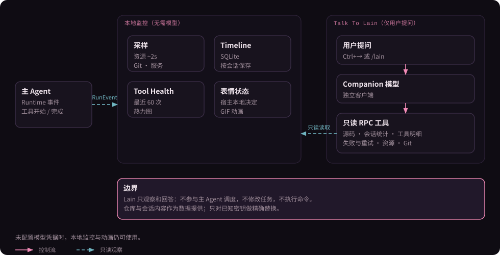
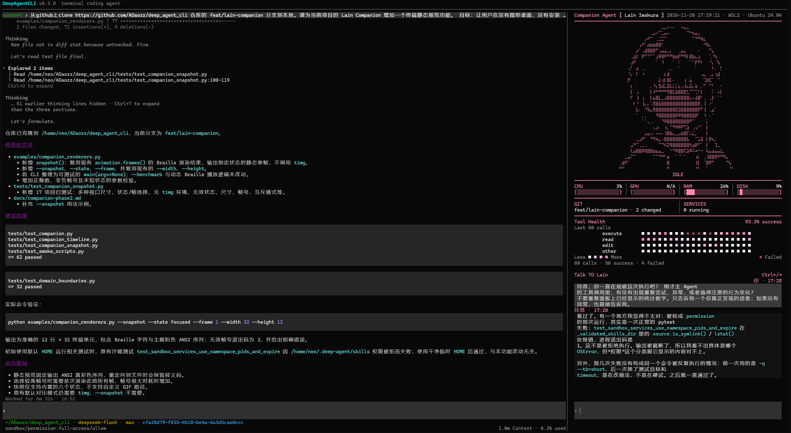
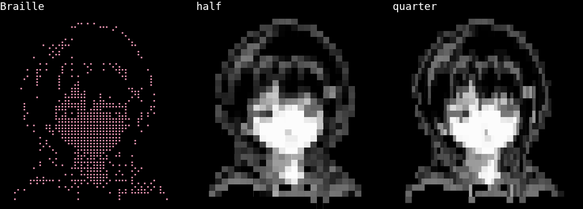

# Lain Companion

**Lain Companion** 是常驻于终端右侧的独立只读观察者与伴随对话面板。它将“纯本地、零模型开销的运行监控”与“按需触发的只读问答”彻底分离。

<div align="center">
  
</div>



---

## 显示与交互方式

- **视口要求**：侧栏占终端总宽度的 `28%`，最低显示尺寸为 `120 列 × 32 行`；宽终端下自动显示，也可通过 `/lain` 命令手动开关。
- **焦点切换与对话**：
  - 按 `Ctrl+→` 进入 Lain 输入框，`Enter` 发送问题，`Ctrl+←` 或 `Esc` 返回主输入框。
  - 在主输入框中直接运行 `/lain <问题>` 也可发起提问（例如 `/lain 最近的失败集中在哪些工具？`）。
  - 运行 `/lain stats` 直接查看最近一轮的工具次数、耗时与成功率，**无需调用模型**。
- **界面体验**：聊天区支持鼠标滚轮，消息气泡与主转录区共用同一套 Markdown 渲染器；切换会话时会清空聊天草稿并恢复目标会话的统计数据。

---

## 本地监控与 Tool Health（零模型开销）

即使未配置 Companion 模型凭据，以下所有监控与动画功能仍完整可用：

### 1. 资源、Git 与服务采样

- **采样频率**：本机 CPU / GPU / RAM / DISK 约每 2 秒采样一次（DISK 显示工作区所在文件系统的已用百分比），Git 复用已有 5 秒探针，运行中的服务状态变化独立入库。
- **SQLite Timeline 存储**：按工作区分库、按会话过滤，采用 WAL 模式与批量事务。每分钟清理 14 天前的历史记录，并将时间序列裁剪至最近 `100,000` 条。
- **表情状态**：GIF 表情动画由宿主本地根据主 Agent 运行事件切换，不由模型控制。

### 2. Tool Health 热力图

Tool Health 跨模型与推理档位统计当前会话最近 **60 次**明确完成（成功或失败）的工具调用：

- **顶部状态行**：右侧展示 `{total} call(s) · {rate}% success`；当窄栏无法放下全部列时，仅在 `shown < total` 时在第二行条件显示 `Last {total} calls · {shown} shown` 范围提示，不重复渲染底部汇总行。
- **分组与网格**：每 3 次调用为一列（最新在右侧），展示调用次数最多的前 3 个工具，其余归入 `other`。组内调用密度用由白到粉的四档方块（`■`）表示，存在失败时以洋红色 `×` 标出。
- **统计标识与显示标签**：内部频次分组、成功率与历史记录始终使用**完整注册名**（同名展示不会合并不同工具）；展示名称统一复用 MCP 身份解析规则（参见 [MCP 集成](mcp.md#统一身份展示)），超宽时按字符宽度截断。
- **未计入项**：取消、未知（`unknown`）和仍在运行中的调用不计入热力图分母；单工具失败率窗口默认保留最近 20 次结果，可通过环境变量 `LAIN_FAILURE_WINDOW`（`1–500`）调整。

### 3. 异常退出与可能重试记录

- 切换或关闭会话时尝试提交缓冲区；若进程异常退出，已入库但无结束事件的调用记为 `unknown`，收到后续完成事件时自动修正。
- 同一运行中、同一工具在前次失败后 60 秒内再次发起且可见参数一致时，标记为“可能的重试”；本地不预生成诊断结论，只在用户提问时提供原始事实供分析。

---

## Talk To Lain：只读对话与数据边界

仅在用户主动提问时，Lain 才会调用独立配置的 Companion 模型客户端，通过只读宿主 RPC 查阅上下文：

### 可用只读工具

- **仓库源码探针**：列出、搜索和读取当前工作区的受支持文本文件（单文件上限 `256 KiB`，默认每次最多读 `50` 行，可通过 `source_read_lines` 配置 `1–200` 行；搜索扫描预算 `1.5s`，最多 `12` 条命中）。
- **遥测查询**：查询当前会话的统计、近期失败、可能重试、时间线、资源采样、Git 与轮次记录。
- **`inspect_current_session`**：只读检查宿主绑定的当前主会话：
  - `recent_tools` — 近期工具执行结果列表
  - `tool_detail` — 按 `tool_call_id` 查看关键参数、输出摘录与退出码
  - `recent_messages` — 查看最近 `1–20` 条用户与主 Agent 可见消息

### 安全与只读边界

1. **绝不介入主 Agent**：Lain 不能修改主任务、不能调用写入/执行工具、不参与主 Agent 调度。
2. **严格会话绑定**：每次提问绑定当前会话、请求序号与随机令牌，宿主在访问前与返回后双重校验；切换会话会使旧查询与回复立即失效。
3. **文件访问限制**：源码探针仅接受工作区相对路径，拒绝隐藏路径、显式凭据文件、PEM 私钥块、受保护配置位置、跨挂载点、符号链接、多重硬链接及非普通文件，校验文件描述符后读取同一 inode。
4. **精确字面量脱敏**：源码与诊断数据仅对配置中的模型密钥（`$llm.…`）与 `redaction.replacements` 做精确字面量替换，不做猜测性正则遮盖，保留原始行号以便定位。
5. **输出预算**：用户问题上限 `4,000` 字，结构化工具响应上限 `6,000` 字节，回复原文展示（去除控制字符，最长约 `1,600` 字）。

---

## GIF 渲染器对比



以下是基于 Debian 13 x86-64、`timg 1.6.0` 与旧版 38 帧 `lain_idle.gif` 的单机实测对比（包含解码与冷启动，RSS 为渲染进程峰值）：

| 视口 | 渲染器 | CPU 秒 | 峰值 MiB | 输出字节 | 绘制字符数 | 帧间隔中位 / P95（ms） |
|---|---|---:|---:|---:|---:|---:|
| 28×16 | Braille | 0.65 | 46.1 | 16,284 | 1,438 | 126 / 155 |
| 28×16 | half | 1.08 | 201.8 | 129,311 | 4,356 | 120 / 121 |
| 28×16 | quarter | 0.81 | 201.8 | 146,933 | 4,810 | 120 / 121 |
| 21×12 | Braille | 0.56 | 45.8 | 10,721 | 843 | 126 / 137 |
| 21×12 | half | 0.87 | 201.8 | 84,250 | 2,863 | 120 / 122 |
| 21×12 | quarter | 0.58 | 201.7 | 99,371 | 3,245 | 120 / 124 |

虽然 `quarter` 在边缘明暗上优于 `half`，但 `timg` 会直接向 stdout 输出隐藏光标与移动光标的全屏控制序列，与 `prompt_toolkit` 的差分重绘存在冲突。因此 Deep Agent CLI 默认使用纯 Python 的 **Braille** 渲染器，运行不依赖 `timg`，且更契合深黑粉点缀的终端视觉风格。

如需在本机复现对比（需自行安装 `timg` 到 `PATH`）：

```bash
python examples/companion_renderers.py
python examples/companion_renderers.py --benchmark
python examples/companion_renderers.py --benchmark --width 21 --height 12
```

Companion 配置项见 [配置参考](configuration.md#lain-侧栏companion)。
