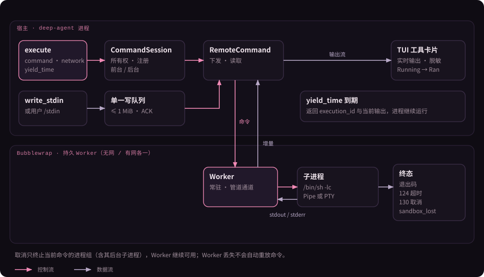

# 交互式命令执行与代码搜索

Deep Agent CLI 的命令执行并不只是“跑完一条命令后贴回一段静态输出”，而是基于 Bubblewrap 持久 Worker 构建的前后台可交互执行系统，同时将内建 `rg` 作为代码搜索与文件发现的统一入口。

<div align="center">
  
</div>

---

## 执行架构概览

命令执行在宿主进程与沙箱进程之间分层协作：

1. **工具层（`execute` / `write_stdin`）**：模型通过 `execute` 启动命令，通过 `write_stdin` 向仍在运行的命令发送输入、轮询输出或执行控制动作。
2. **宿主控制层（`CommandSession` / `RemoteCommand`）**：管理命令所有权、前后台注册、输出增量读取、单一写队列（1 MiB 上限与 ACK 确认）以及流式凭据脱敏。
3. **沙箱执行层（持久 Worker）**：宿主在 Bubblewrap 沙箱内常驻两个独立的持久 Worker——**无网沙箱**（`--unshare-net`）与**有网沙箱**。每次 `execute` 由对应 Worker 派生独立的 `/bin/sh -lc` 子进程组。

关键运行语义：

- **每次调用都是独立 Shell**：工作目录切换（`cd`）与 Shell 变量不会跨调用保留，文件变更会持久保留在工作区或已挂载目录中。
- **有网与无网沙箱相互隔离**：两个 Worker 共享工作区和显式声明的额外挂载，但拥有各自的 `/tmp` 和进程空间；需要共享 `/tmp` 文件或后台进程的命令必须使用相同的 `network` 设置。
- **取消不破坏 Worker**：取消或超时只终止当前命令的进程组（含其派生的后台子进程），持久 Worker 保持可用。
- **Worker 丢失不自动重放**：若沙箱 Worker 异常退出，当前命令以 `sandbox_lost` 终态返回，不会静默重试有副作用的命令。

---

## `execute` 参数与模式

`execute` 的核心参数如下：

| 参数 | 说明 |
|---|---|
| `command` | 在沙箱工作区根目录下通过 `/bin/sh -lc` 执行的 Shell 命令。 |
| `timeout` | 命令超时时间（秒）。超时后终止整个进程组并返回退出码 `124`。 |
| `network` | 是否允许该命令访问宿主网络（互联网、本机 `localhost` 与局域网）。在 `ask`/`auto` 下默认 `false`；在 `allow` 模式下始终使用有网沙箱（单次 `network=false` 不会关闭）。 |
| `yield_time` | 同步等待的最长时间（秒）。若到期时命令仍未结束，工具立即返回 `execution_id` 与当前已产生的输出，进程继续在后台运行。 |
| `interactive` | 是否开启可写标准输入（Pipe 模式）。 |
| `tty` | 是否为子进程分配伪终端（PTY 模式），用于需要 TTY 的交互式程序或终端色彩/提示符行为。 |

输入通道模式由 `tty` 与 `interactive` 共同决定：

- `tty=true` → **PTY 模式**
- `tty=false, interactive=true` → **Pipe 模式**
- `tty=false, interactive=false` → **只读无输入模式（`none`）**

---

## `write_stdin` 与用户 `/stdin` 接管

当命令在 `yield_time` 到期后仍在后台运行，工具结果会包含 `execution_id`。后续既可以由 Agent 通过 `write_stdin` 交互，也可以由用户在 TUI 中直接接管。

### `write_stdin` 协议

| 参数 | 说明 |
|---|---|
| `execution_id` | 运行中命令的标识。 |
| `chars` | 要写入子进程标准输入的文本（可包含 `\n` 或控制字符）。 |
| `yield_time` | 写入或轮询后等待新输出的时长（秒）。 |
| `action` | 控制动作，支持写入/轮询、关闭标准输入（EOF）或取消进程。 |

- **空轮询不视为副作用**：当 `write_stdin` 仅用于轮询新输出（无写入且无取消/关闭动作）时，不会触发副作用审批。
- **单一写队列与 ACK**：所有发往子进程的标准输入都经过单一有序写队列，单次负载上限为 **1 MiB**，并等待 Worker 确认（ACK），避免并发写入交错或缓冲失控。

### 在 TUI 中使用 `/stdin`

在交互式终端中，用户可以随时介入任意正在运行的交互式命令：

- `/stdin` 或 `/stdin <execution_id>` — 附着到正在运行的交互式命令，输入框直接向该进程发送内容。
- **PTY 模式快捷键**：`Ctrl+C` 发送 `\x03`（SIGINT），`Ctrl+D` 发送 `\x04`（EOF）。
- **Pipe 模式快捷键**：`Ctrl+C` 触发命令取消，`Ctrl+D` 关闭标准输入管道。
- **分离会话**：按 `Esc` 立即脱离进程输入，回到普通对话输入，不会终止后台进程。

---

## 终态、超时与清理

命令结束时可能进入以下终态：

| 终态 | 含义 |
|---|---|
| 正常退出码（如 `0` / 非 `0`） | 子进程正常结束，Worker 会进行短时输出排空（`0.1s`）确保尾部日志不丢失。 |
| 退出码 `124` | 命令超过 `timeout` 上限，进程组被强制终止。 |
| 退出码 `130` | 被用户（`Esc` / `/stdin` `Ctrl+C`）或取消信号中断；终止信号在宽限期（`5s`）内确认清理。 |
| `sandbox_lost` | 承载该命令的持久 Worker 意外退出。 |

已结束的命令记录会在内存中保留有限数量与生命周期（默认最多保留 `64` 条记录、TTL `300s`），过期后自动清理，防止长会话持续占用内存。

---

## 内建代码搜索（`rg`）

`grep` 和 `glob` 不作为独立的模型工具注册。代码搜索与文件发现统一通过 `execute` 调用沙箱内的 `rg`（ripgrep）：

```bash
rg -n 'pattern' path
rg --files -g 'pattern' path
```

### 定位与挂载机制

- **自动随包安装**：`ripgrep-bin>=15.2.0,<16` 已包含在项目 Python 依赖中，通常无需手动安装系统 `ripgrep` 包。
- **解析顺序（`resolve_rg()`）**：
  1. 当前 Python 环境（包括 venv / pipx 环境）scripts 目录中可执行的 `rg`；
  2. 系统 `PATH` 中的 `rg`；
  3. 两处均不可用时，不挂载 `/run/deep-agent/rg`，且 `execute` 工具描述与启动日志会明确声明代码搜索不可用，不会静默返回空结果。
- **只读挂载**：Bubblewrap 将定位到的 `rg` 只读挂载到 `/run/deep-agent/rg`，并将 `/run/deep-agent` 置于沙箱 `PATH` 最前（即使配置了自定义 `env_set.PATH` 或继承宿主 `PATH` 也会保留）。
- **默认过滤行为**：位于 Git 仓库中时遵守 `.gitignore`、`.ignore`、`.rgignore` 与 `.git/info/exclude`，默认跳过隐藏文件、符号链接与二进制文件；需要放宽时直接使用 `--hidden`、`--no-ignore`、`-L` 等 `rg` 参数。
- **权限与安全**：搜索完全复用 `execute` 的审批与沙箱边界；Agent 不会也不能自行下载或安装 `rg`。

### 系统备选安装与验证

如需使用系统包管理器安装 `rg`（WSL2 用户需在 WSL2 Linux 内安装）：

```bash
# Ubuntu / Debian / WSL2
sudo apt update && sudo apt install ripgrep

# Fedora
sudo dnf install ripgrep

# Arch Linux
sudo pacman -S ripgrep
```

验证 Deep Agent 实际解析到的 `rg`：

```bash
python - <<'PY'
import subprocess
from agent.execution.ripgrep import resolve_rg

rg = resolve_rg()
if rg:
    print(rg, flush=True)
    subprocess.run([rg, "--version"], check=True)
else:
    print("rg unavailable")
PY
```

使用 `pipx` 安装时也可直接检查其内置二进制：

```bash
"$(pipx environment --value PIPX_LOCAL_VENVS)/deep-agent-cli/bin/rg" --version
```
