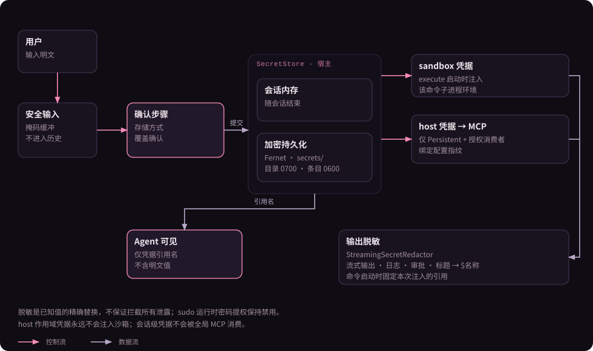

# 安全凭据管理

Deep Agent CLI 提供独立的凭据录入、存储、注入与脱敏链路，目标是在 Agent 需要使用 API Key、Token 或服务密码时，**让模型只接触凭据引用名，不接触明文值**。

  

---

## 核心原则

1. **明文不出宿主凭据边界**：用户通过掩码输入框提交凭据，输入缓冲独立于普通对话历史，不会写入会话记录或返回给模型。
2. **模型只见引用名**：提交完成后，模型收到的工具结果中仅包含凭据引用名（例如 `GITHUB_TOKEN`），不包含明文值。
3. **显式作用域隔离**：凭据严格区分 `sandbox` 与 `host` 两种作用域——`host` 凭据永远不会注入沙箱命令；会话级凭据永远不会被全局 MCP 服务消费。
4. **系统独占确认授权**：存储方式选择与覆盖已有凭据的确认步骤只能由系统创建与提交，模型无法伪造字段 ID 绕过确认。

---

## 凭据录入方式

### 1. Agent 主动请求（`request_human_input`）

当任务需要凭据时，模型可调用 `request_human_input` 并在表单中声明 `type: "secret"` 的字段，同时注明用途与目标作用域（`host` 或 `sandbox`）。

- 终端弹出专用的安全输入面板，用户输入以掩码形式显示，不写入 prompt 历史；粘贴时自动去除换行符。
- 涉及覆盖已有同名凭据或选择存储方式（仅本次会话 / 加密持久化）时，由系统自动追加确认步骤，并在提交前明确展示风险说明与目标位置。
- 系统保留字段命名空间（如 `__confirm_overwrite__`、`__secret_storage__:`）在字段规范化与工具 Schema 入口统一拒绝模型传入，普通业务字段 `values` 与安全授权状态（`_secret_values`、`_secret_confirmed_storages`、`overwrite_confirmed`）严格分离。

### 2. 用户手动管理（`/secrets`）

在 TUI 中输入 `/secrets` 可随时查看、新增、覆盖或删除托管凭据：

- 查看当前已管理的凭据清单（名称、作用域、存储位置与授权消费者），界面始终不显示明文。
- 新增或更新凭据时，与 Agent 凭据请求复用同一套掩码输入、存储选择与覆盖确认流程。
- 删除凭据后立即从对应存储中移除，并更新脱敏集合状态。

---

## 命名与存储模型

### 引用名规则

凭据引用名必须匹配合法环境变量格式 `[A-Za-z_][A-Za-z0-9_]*`，且禁止使用可能劫持加载器或沙箱运行环境的保留变量名（`RESERVED_SECRET_NAMES`）以及 `LC_*` 前缀，包括：

`PATH`、`HOME`、`PWD`、`TMPDIR`、`USER`、`LOGNAME`、`SHELL`、`TERM`、`LANG`、`LC_ALL`、`LD_PRELOAD`、`LD_LIBRARY_PATH`、`LD_AUDIT`、`PYTHONPATH`、`PYTHONHOME`、`PYTHONSTARTUP`、`NODE_OPTIONS`、`BASH_ENV`、`ENV`、`IFS`、`DEEP_AGENT_CONFIG`、`DEEP_AGENT_EXECUTION_OWNER`。

### 存储方式（`SecretStore`）

| 存储类型 | 标识 | 生命周期与落盘方式 |
|---|---|---|
| **会话内存** | `session` | 仅存于当前进程内存，进程或会话结束后自动消失，不落盘。 |
| **加密持久化** | `persistent` | 使用 Fernet 对称加密存储在 `~/.deep-agent/secrets/` 下；目录权限强制 `0700`，密钥与凭据条目权限 `0600`，写入加文件锁（`fcntl`）并采用原子替换。 |
| **环境变量** | `environment` | 读取宿主环境已有变量（只读引用，不由凭据面板直接覆写宿主进程环境）。 |

---

## 作用域与注入边界

### `sandbox` 作用域（命令执行）

- 仅用于沙箱内的 `execute` 命令。
- 在命令启动时按本次需要的凭据集合注入到**该命令对应的子进程环境**，不写入持久 Worker 的全局环境，也不会泄漏给无关命令或跨会话的 `/proc` 环境检查。
- `host` 作用域凭据永远不会注入到任何沙箱命令中。

### `host` 作用域（MCP 与宿主服务）

- 仅允许以 **加密持久化（`persistent`）** 方式供 MCP 等宿主消费者使用；`session` 级凭据不会被全局 MCP 消费。
- **消费者绑定与配置指纹**：每个被 MCP 服务引用的凭据都绑定授权消费者及其配置 `fingerprint()`。如果 MCP 服务的连接目标、命令或关键配置发生变更导致指纹不匹配，消费将被拒绝（`SecretAccessError`），防止凭据被静默重定向到未授权端点。

---

## 流式输出脱敏与已知边界

所有可能暴露给模型或写入界面的文本通道均经过 `StreamingSecretRedactor` 脱敏处理，包括：

- `execute` 实时流式输出与最终返回内容
- 审批面板摘要与完整命令预览
- 工具卡片标题、工具输出与 SubAgent 摘要日志

脱敏规则与诚实边界：

1. **精确替换**：脱敏基于已知凭据明文的精确匹配替换为 `$名称`（例如 `$GITHUB_TOKEN`），并在命令启动时固定本次注入的引用集合（含命令运行期间被更新或移除的已退役引用，确保该命令剩余输出仍可脱敏）。
2. **不是全能防泄露边界**：如果命令对凭据进行了编码、切分、反转或加密变形（如 Base64、Hex、逐字符打印），精确匹配脱敏**无法**拦截。
3. **沙箱内 `sudo` 提权保持禁用**：Bubblewrap 沙箱启用 `NoNewPrivs` 语义，不会为运行时密码提权放开特权边界。

更多沙箱隔离与审批边界说明，请参见 [沙箱与权限](sandbox.md)。
