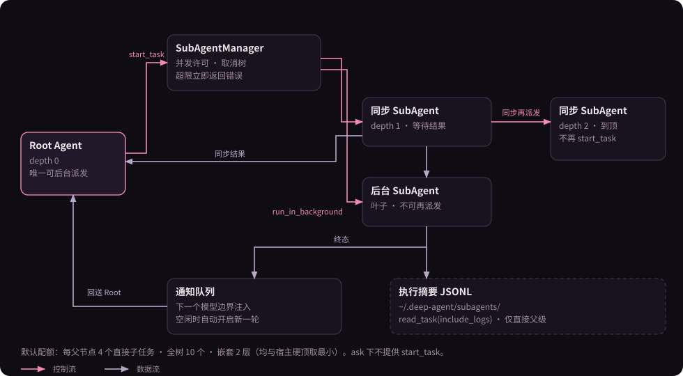

# SubAgent 任务委派

当任务能够拆分为多个独立、互不干扰的子问题（例如并行调研多个模块、独立运行专项检查）时，主 Agent 可通过 `start_task` 派发拥有独立上下文的 SubAgent。

  

---

## 委派模型与工具

SubAgent 生命周期由 `SubAgentManager` 与三个工具协同管理：

| 工具 | 职责 |
|---|---|
| `start_task` | 启动一个新的 SubAgent。支持同步等待结果，或由根 Agent 以 `run_in_background=true` 派发后台叶子任务。 |
| `read_task` | 查询子任务状态与结果；直接父级可通过 `include_logs=true` 读取受限的摘要日志。 |
| `cancel_task` | 取消运行中的子任务及其整个取消树（含嵌套子任务与运行中的命令）。 |

### 同步与后台规则

- **同步子任务**：父 Agent 阻塞等待结果返回；若尚未到达嵌套深度上限（`depth < max_subagent_depth`），同步子任务可继续向下派发新的同步子任务。
- **后台子任务（仅 Root Agent）**：只有位于 `depth 0` 的根 Agent 可以派发后台子任务；后台子任务是**叶子节点**，不可再派发子任务。
- **异步结果回送**：后台子任务到达终态后，结果进入通知队列；在下一个模型边界自动注入，如果主会话当时处于空闲状态，Runtime 会自动开启新一轮处理结果。

---

## 配额与权限边界

### 并发与深度硬顶

`SubAgentConfig` 的默认值同时也是宿主硬顶；用户配置只能**收紧**，不能突破上限（实际生效值为 `min(配置值, 宿主硬顶)`）：

| 配置项 | 默认值 / 宿主硬顶 | 含义 |
|---|---|---|
| `subagents.enabled` | `true` | 是否启用 SubAgent 委派。 |
| `subagents.background` | `true` | 是否向根 Agent 开放后台委派能力。 |
| `subagents.max_concurrent` | `4` | 每个父 Agent 同时运行的直接子任务上限。 |
| `subagents.max_total` | `10` | 整棵任务树（不含 Root）同时运行的 SubAgent 总量上限。 |
| `subagents.max_subagent_depth` | `2` | 根 Agent 以下允许的最大嵌套层数（`2` 表示允许 depth 1 与 depth 2；depth 2 不再注册 `start_task`）。 |
| `subagents.model` | `null`（继承主模型） | 为 SubAgent 指定独立模型（`"来源/模型"` 格式）。 |
| `subagents.reasoning_effort` | `"default"` | 为 SubAgent 指定独立推理强度（不支持 `"auto"`）。 |

超过并发或总量限制时，`start_task` 立即返回明确错误，不会阻塞等待或静默排队。

### 权限与工作区隔离

- **`ask` 模式下不暴露委派**：在 `ask` 权限模式下，系统不注册 `start_task`，避免后台并发子任务产生不可控的交互审批冲突。仅在 `auto` 或 `allow` 模式下可用。
- **权限继承与独立上下文**：子任务共享同一授权工作区与 Bubblewrap 沙箱，继承父级权限模式，但拥有独立的对话历史与 LangGraph checkpoint，避免中间推理和大量工具输出污染主上下文。
- **TUI 卡片呈现**：每个子任务在终端中以独立卡片显示状态与摘要，按 `Ctrl+A` 可展开或折叠完整返回结果；子任务内部思考过程与原始工具输出保持隔离。

---

## 隔离摘要日志（JSONL）

每个 SubAgent 的执行摘要写入 `~/.deep-agent/subagents/` 下的隔离 JSONL 日志中：

- 仅**直接父级**可通过 `read_task(include_logs=true)` 查阅对应子任务的摘要日志，防止跨分支越权读取。
- 写入日志前统一经过已知凭据脱敏处理，确保凭据明文不落盘到子任务摘要中。

完整配置字段示例见 [配置参考](configuration.md#subagent-委派)。
